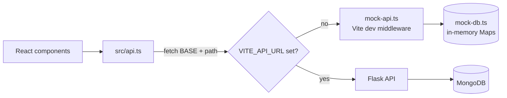
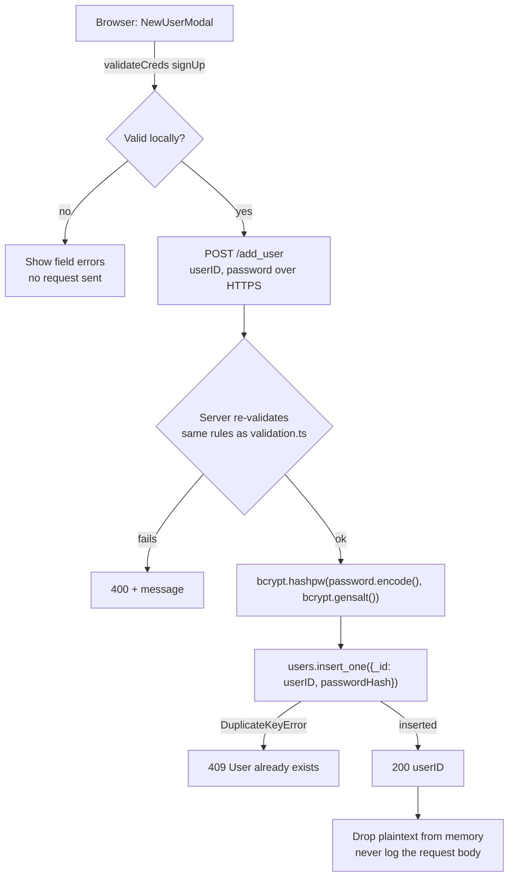
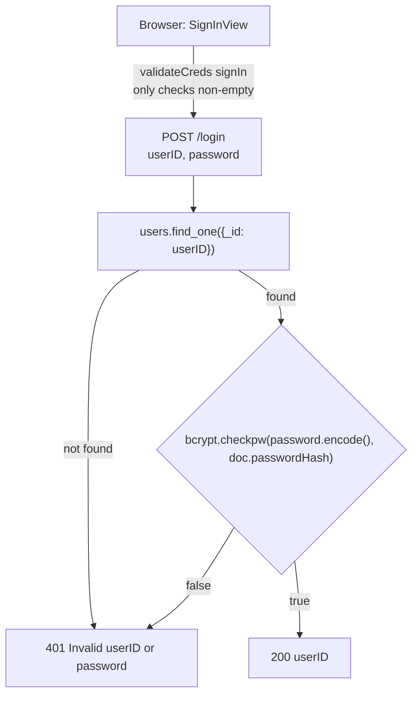
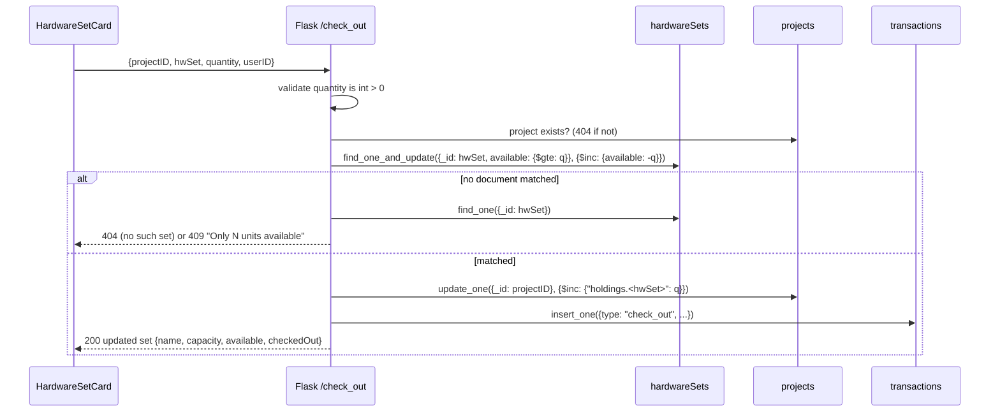

# API Roadmap: from the Mock API to Flask + MongoDB

## Our transition from Mock API to Flask

Last updated: 10/12/26

This doc lists what has to change in `haas-app/src/api.ts`, in the backend, and in the database so the
frontend can stop using the mock (`haas-app/mock-api.ts` + `haas-app/mock-db.ts`) and talk to the real
Flask + MongoDB app. It covers:

1. [How the frontend connects today](#1-how-the-frontend-connects-today)
2. [Existing routes the backend must match](#2-existing-routes-the-backend-must-match)
3. [MongoDB collections](#3-mongodb-collections)
4. [Password hashing flow](#4-password-hashing-flow)
5. [Accurate check-out / check-in](#5-accurate-check-out--check-in)
6. [New routes](#6-new-routes)
7. [Frontend changes (`api.ts` and friends)](#7-frontend-changes-apits-and-friends)
8. [Backend files to create](#8-backend-files-to-create)
9. [Deferred (not in this iteration)](#9-deferred-not-in-this-iteration)
10. [Open questions](#10-open-questions)

`docs/api_calls.pdf` is the original hand-drawn route spec. This doc follows it except where noted (see the
bcrypt correction in section 4).

---

## 1. How the frontend connects today



- `api.ts` is the only file that makes HTTP requests. Components call `api.*` and never use `fetch` directly.
- `BASE = import.meta.env.VITE_API_URL ?? ''`. When the variable is unset, `vite.config.ts` installs the
  mock middleware and requests go to the same origin.
- **Error contract:** a non-2xx response must have a JSON body `{ "error": "<message>" }`. `api.ts` turns
  that into an `ApiError(status, message)`, and components show the message as-is. So **write backend
  error messages for the user to read.**
- **Status codes the frontend relies on:**
  - `400`: bad input
  - `401`: bad login
  - `404`: missing project or hardware set
  - `409`: conflict (taken ID, already a member, not enough units)
  - `502`/`503`/`504`: server down, which turns the status light offline
- `connection.ts` re-checks `/get_all_hw_names` every 5s while offline, so that route must stay cheap
  and need no auth.
- `session.ts` makes requests for the same `projectID:hwSet` run one at a time in the browser. That only
  covers one tab. The backend still has to be correct when several users act at once (section 5).

---

## 2. Existing routes the backend must match

These are already called by `api.ts` and implemented in the mock. Flask has to accept the same shapes and
return the same statuses, so the frontend works with no changes when `VITE_API_URL` is set.

| Route | Method | Request | 200 response | Errors |
|---|---|---|---|---|
| `/login` | POST | `{ userID, password }` | `{ userID }` | 401 `Invalid userID or password` |
| `/add_user` | POST | `{ userID, password }` | `{ userID }` | 400 invalid creds, 409 `User already exists` |
| `/get_user_projects_list` | GET | `?userID=` | `{ projects: Project[] }` (empty array if none) | — |
| `/get_project_info` | GET | `?projectID=` | `{ projectID, name, description, members: string[] }` | 404 |
| `/create_project` | POST | `{ userID, projectID, name, description }` | `Project` | 400 invalid ID, 409 ID taken |
| `/join_project` | POST | `{ userID, projectID }` | `Project` | 404 no such project, 409 `You are already part of this project` |
| `/get_all_hw_names` | GET | — | `{ names: string[] }` | — |
| `/get_hw_info` | GET | `?name=` | `{ name, capacity, available }` | 404 |
| `/check_out` | POST | `{ projectID, hwSet, quantity }` | updated `HardwareSet` | 400 bad quantity, 404, 409 not enough available |
| `/check_in` | POST | `{ projectID, hwSet, quantity }` | updated `HardwareSet` | 400, 404, 409 project holds fewer units |

Notes for the backend team:

- **The empty list is not an error.** `/get_user_projects_list` returns `{ projects: [] }` when the user
  has no projects. The PDF suggested an "error" for this case, but the frontend already shows "You are not
  part of any project yet." from an empty array.
- **Joining when already a member.** `/join_project` must still return **409** in that case. The frontend
  catches that 409 and redirects to the project
  (`ProjectsView.tsx`, `join`), and a commented-out version there shows the error instead.
- **Creating a project makes the creator a member,** in the same request.
- **Quantity type.** `quantity` arrives as a JSON integer. Reject strings, decimals, `<= 0` and booleans
  with 400. (In Python, `True` is an `int`, so check `type(q) is int`.)
- **Re-run the validation rules.** Repeat the `validation.ts` rules on the server: allowed characters are
  letters and digits only, and the min lengths are still placeholders. Browser checks can be bypassed.
- **Not built yet:** `/create_hardware_set` is listed in the README, but nothing calls it.

---

## 3. MongoDB collections

The mock keeps five Maps. In Mongo they become three collections plus one new one for history. Membership
and holdings live **inside the project document**, so there is one source of truth and no second table to
keep in sync.

| Mock table (`mock-db.ts`) | Mongo collection | Document shape |
|---|---|---|
| `users` (userID → **plaintext** password) | `users` | `{ _id: userID, passwordHash: <bcrypt bytes> }` |
| `projects` | `projects` | `{ _id: projectID, name, description, createdBy, members: [userID], holdings: { HWSet1: 20, HWSet2: 0 } }` |
| `memberships` (userID → projectIDs) | *(folded into `projects.members`)* | — |
| `holdings` (projectID → hwSet → units) | *(folded into `projects.holdings`)* | — |
| `hardware` | `hardwareSets` | `{ _id: "HWSet1", capacity: 100, available: 70 }` |
| *(new)* | `transactions` | see section 6.3 |

Why it's laid out this way:

- **Using the ID as `_id`** makes "already taken" checks free. Inserting a duplicate raises
  `pymongo.errors.DuplicateKeyError`, which maps straight to 409 with no read-then-write race
  (this is the "unique indexing" note in the PDF).
- **`members` as an array** lets `/join_project` add a user with one atomic update:
  `update_one({_id: pid, members: {$ne: uid}}, {$push: {members: uid}})`.
  - `matched_count == 0` → read again to tell "no such project" (404) from "already a member" (409).
  - Add an index on `members` so `/get_user_projects_list` (`find({members: uid})`) stays fast.
- **`holdings` on the project** means "what this project has checked out" is one read, which is
  what section 6.1 needs.
- **Invariant:** for each set, `capacity == available + sum of every project's holdings for that set`.
  The mock seed data already follows this (see the comment in `mock-db.ts`). A pytest should check it
  after a mixed run of check-outs and check-ins.

---

## 4. Password hashing flow

Passwords are hashed with **bcrypt** on the server only. The browser sends the plaintext password over
HTTPS, and the server never stores it or logs it.

> **Correction to `api_calls.pdf`:** the PDF says to "hash the input password and compare it to the
> database hash". That doesn't work with bcrypt, because every hash has its own random salt, so hashing the
> same password twice gives different results. Use `bcrypt.checkpw(input, stored_hash)` instead. It reads
> the salt out of the stored hash and does the comparison.

### `/add_user` (sign up)



### `/login` (sign in)



Rules:

- **One message for both failures.** An unknown user and a wrong password both return the same 401
  message, so nobody can use the login form to find out which userIDs exist.
- **Store the hash as-is.** Keep `passwordHash` as the bytes bcrypt returns. Don't decode, re-encode or
  trim it.
- **Don't trim passwords.** The frontend doesn't, and changing that later would lock out existing users.
- **Keep the mock in plaintext.** The mock stores plaintext on purpose (dev only, flagged in
  `mock-db.ts`). Don't copy that into Flask.

---

## 5. Accurate check-out / check-in

The mock is single-threaded, so `if qty > available` followed by `available -= qty` is safe there. In
Flask with several users, reading the value, checking it in Python, then writing it back is a race: two
users can both see 10 available and both take 10. The fix is to put the check **inside** the update.

### Check-out



### Check-in

This is the same flow in reverse. The condition goes on the **project**:

- Update: `update_one({_id: pid, "holdings.<hwSet>": {$gte: q}}, {$inc: {"holdings.<hwSet>": -q}})`
- No match → 409 `Project <pid> only holds N units of <hwSet>`.
- Then `$inc: {available: q}` on the set, capped by capacity, which follows from the invariant.

### Keeping the two writes consistent

Each operation changes two documents (the set and the project). Pick one of these:

1. **Mongo transaction (recommended if we deploy on Atlas).** Wrap both updates and the transaction insert
   in `with client.start_session() as s: s.with_transaction(fn)`. Atlas clusters, including the free tier,
   are replica sets, so they support this. A local standalone `mongod` doesn't, so dev would need
   `--replSet` or a Docker replica-set image.
2. **Ordered writes with undo (if transactions aren't available).** Do the conditional update first, since
   that's the step that can fail. If the second write fails, undo the first with the opposite `$inc` and
   return 500. This is simpler, but a crash between the two writes can break the invariant, so the
   section 3 invariant test matters more here.

Whichever we pick, the frontend behavior doesn't change. It already refetches `/get_hw_info` after any
409 or network failure (`HardwareSetCard.tsx`).

---

## 6. New routes

### 6.1 Units checked out per project

**Why:** the Hardware page can't show "Checked Out" yet, and the check-in limit is only enforced by the
server (see the comments in `HardwareSetCard.tsx`).

**Proposal:** extend the existing routes instead of adding a new one.

| Route | Change |
|---|---|
| `GET /get_hw_info?name=&projectID=` | `projectID` is optional. When given, also return `checkedOut: projects[pid].holdings[name] ?? 0` |
| `POST /check_out`, `POST /check_in` | Response also includes `checkedOut` for the request's project |

Optionally, add `GET /get_project_hardware?projectID=` → `{ holdings: { HWSet1: 20, HWSet2: 0 } }` if a
Projects-page summary is wanted later.

### 6.2 Project members (already wired, backend needed)

`/get_project_info` already returns `members` and the Hardware page (`ResourcesView.tsx`) shows them. The
backend just returns `projects[pid].members`. It needs no new route.

### 6.3 User and project history

**Why:** a record of who checked out or returned what, and when, that lasts across sessions.

To record *who* did each operation, add **`userID` to the `/check_out` and `/check_in` request bodies**
(the frontend knows it from sign-in).

`transactions` document:

```json
{
  "_id": "<ObjectId>",
  "type": "check_out",
  "userID": "alice",
  "projectID": "edgeproj42",
  "hwSet": "HWSet1",
  "quantity": 5,
  "availableAfter": 65,
  "at": "<UTC datetime>"
}
```

| Route | Method | Request | 200 response |
|---|---|---|---|
| `/get_project_history` | GET | `?projectID=&limit=50` | `{ transactions: Transaction[] }` (newest first) |
| `/get_user_history` | GET | `?userID=&limit=50` | `{ transactions: Transaction[] }` (newest first) |

Implementation notes:

- **Indexes:** add `{projectID: 1, at: -1}` and `{userID: 1, at: -1}`. Query with `.sort("at", -1).limit(n)`.
- **Write path:** insert the transaction in the same transaction or ordered write as section 5. If it isn't
  written, the history is wrong.
- **Date format:** send `at` as ISO-8601 (`datetime.isoformat()`). The frontend formats it for display.

### 6.4 Summary of new and changed routes

| Route | New or changed | Needed for |
|---|---|---|
| `/get_hw_info` + `projectID` param, `checkedOut` field | changed | Checked Out stat, client-side check-in limit |
| `/check_out`, `/check_in` + `userID` in body, `checkedOut` in response | changed | history, Checked Out stat |
| `/get_project_history` | new | project history panel |
| `/get_user_history` | new | user history panel |
| `/get_project_hardware` | new, optional | per-project summary on the Projects page |
| `/create_hardware_set` | new, admin only | seeding sets without touching the DB by hand |

---

## 7. Frontend changes (`api.ts` and friends)

### `src/api.ts`

```ts
export interface HardwareSet {
  name: string
  capacity: number
  available: number
  checkedOut?: number // present when the request named a project
}

export interface Transaction {
  type: 'check_out' | 'check_in'
  userID: string
  projectID: string
  hwSet: string
  quantity: number
  availableAfter: number
  at: string // ISO-8601
}

// in `api`:
getHardwareInfo: (name: string, projectID?: string) =>
  request<HardwareSet>('/get_hw_info' + q(projectID ? { name, projectID } : { name })),
checkOut: (userID: string, projectID: string, hwSet: string, quantity: Quantity) =>
  post<HardwareSet>('/check_out', { userID, projectID, hwSet, quantity }),
checkIn: (userID: string, projectID: string, hwSet: string, quantity: Quantity) =>
  post<HardwareSet>('/check_in', { userID, projectID, hwSet, quantity }),
getProjectHistory: (projectID: string) =>
  request<{ transactions: Transaction[] }>('/get_project_history' + q({ projectID })),
getUserHistory: (userID: string) =>
  request<{ transactions: Transaction[] }>('/get_user_history' + q({ userID })),
```

### Callers that have to change with it

- **`HardwareSetCard.tsx`:**
  - Pass `userID` to `checkOut`/`checkIn`.
  - Use `hwSet.checkedOut` as the check-in `max` in `validateQuantity`, replacing `Number.MAX_SAFE_INTEGER`.
  - Uncomment the Checked Out stat and switch to `hw-stats-3`.
- **`ResourcesView.tsx`:**
  - Take a `userID` prop from `App.tsx`.
  - Call `getHardwareInfo(n, projectID)` so `checkedOut` comes back.
  - Add a history panel built from `getProjectHistory`.
- **`App.tsx`:** pass `userID` down to `ResourcesView`.
- **Mock (`mock-api.ts`, `mock-db.ts`):**
  - Add the same fields and routes, with a `transactions` array in `MockDB`, so `npm run dev` and the
    tests keep working without a backend.
  - Update `mock-api.test.ts` and `src/api.test.ts` for the new arguments.

### Config files to add

- **`haas-app/.env.example`** (checked in): `VITE_API_URL=http://localhost:5000`. The real `.env` stays
  gitignored.
- **Cross-origin calls.** In dev the Vite server (5173) and Flask (5000) run on different ports, so the
  browser blocks cross-origin calls unless one of these is in place:
  1. **Vite `server.proxy` (preferred, no new dependency).** Proxy the API routes to Flask in
     `vite.config.ts` and leave `VITE_API_URL` unset. The mock would then need its own switch (for
     example `VITE_USE_MOCK=1`) instead of keying off `VITE_API_URL`.
  2. **CORS headers on Flask.** Set `Access-Control-Allow-Origin` to the frontend origin in an
     `@app.after_request` hook, and answer `OPTIONS` preflights.
  - **In production,** serve the built frontend and the API from the same origin when possible, so
    neither is needed.

---

## 8. Backend files to create

A suggested layout. The backend team owns the final structure.

```
backend/
  app.py            Flask app factory, registers blueprints, error handler → {"error": msg}
  db.py             one MongoClient from MONGO_URI env var; collection handles; index creation
  auth_routes.py    /login, /add_user (bcrypt)
  project_routes.py /create_project, /join_project, /get_user_projects_list, /get_project_info
  hw_routes.py      /get_all_hw_names, /get_hw_info, /check_out, /check_in, history routes
  validation.py     same rules as haas-app/src/validation.ts
  seed.py           creates HWSet1/HWSet2 (capacity 100) if missing
  tests/            pytest: one file per routes module + invariant test (section 3)
  requirements.txt  flask, pymongo, bcrypt, pytest
  .env.example      MONGO_URI=..., FLASK_ENV=development
```

Things to get right:

- **One `MongoClient` per process,** created once in `db.py`. Don't create one per request.
- **Read secrets from the environment.** `MONGO_URI` and any secret come from env vars, and `.env` stays
  out of git (CLAUDE.md).
- **Map Mongo errors to statuses:** `DuplicateKeyError` → 409, a missing document → 404, and anything else
  → 500 with a generic message. Log details on the server, but never log the request body on auth routes.

---

## 9. Deferred (not in this iteration)

- **Authorization.** Right now any signed-in user can call `/check_out` for any project ID. Later the
  backend should check that `userID ∈ projects[pid].members` before changing holdings (403 otherwise).
  The frontend can't enforce this, because the request can be sent without the UI.
- **Sessions and tokens.** `userID` lives in React state and is sent in each request. A real session
  (signed cookie or token) would let the server get `userID` itself instead of trusting the body. Until
  then, nothing proves the `userID` in a request belongs to the signed-in user.
- **Persisted UI history.** The routes in 6.3 store history. A page to show it is separate work.

---

## 10. Open questions

- **Backend stack.** The README "Architecture" table still says Node.js + Java, while CLAUDE.md and the
  team table say Python Flask. This doc assumes Flask. Update the README once the team confirms.
- **Validation lengths.** `MIN_USERID_LENGTH`, `MIN_PASSWORD_LENGTH` and `MIN_PROJECT_ID_LENGTH` in
  `validation.ts` are still 0. The frontend and backend have to agree on the real values.
- **Dev database.** Will dev run against Atlas (transactions available) or a local `mongod` (needs
  replica-set mode for section 5, option 1)?
