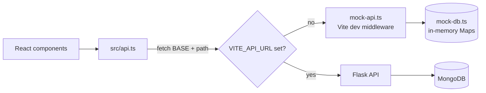
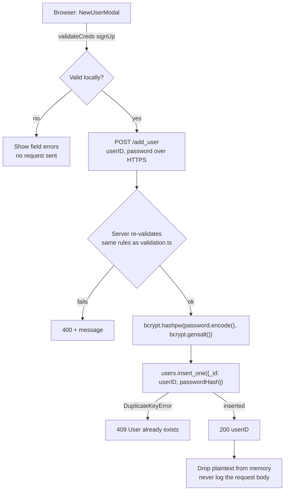
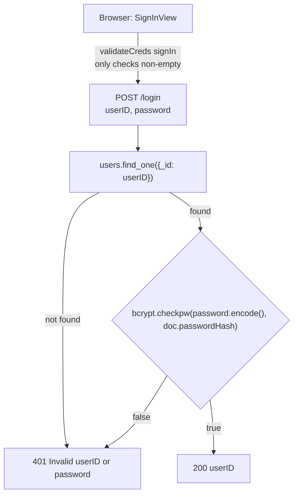
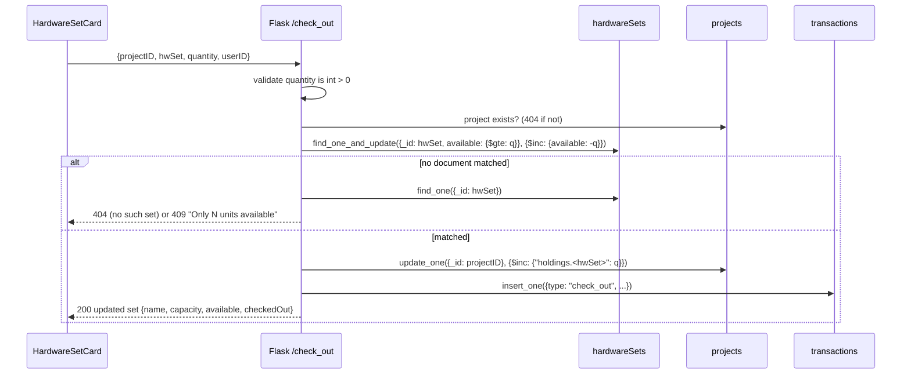

# API Roadmap: from the Mock API to Flask + MongoDB

## Our transition from the Mock API to Flask

Last updated: 10/12/26

Right now the frontend runs against a mock server (`haas-app/mock-api.ts` + `haas-app/mock-db.ts`). This doc is
our plan for switching it over to the real Flask + MongoDB backend: what has to change in
`haas-app/src/api.ts`, what the backend needs to build, and how the database should be laid out. Sections:

1. [How the frontend connects today](#1-how-the-frontend-connects-today)
2. [Existing routes the backend must match](#2-existing-routes-the-backend-must-match)
3. [MongoDB collections](#3-mongodb-collections)
4. [Password hashing flow](#4-password-hashing-flow)
5. [Accurate check-out / check-in](#5-accurate-check-out--check-in)
6. [New routes](#6-new-routes)
7. [Frontend changes (`api.ts` and friends)](#7-frontend-changes-apits-and-friends)
8. [Backend files to create](#8-backend-files-to-create)
9. [Deferred (not in this iteration)](#9-deferred-not-in-this-iteration)
10. [Open questions](#10-open-questions)

We started from the hand-drawn route spec in `docs/api_calls.pdf`. This doc follows it except where noted
below. The biggest difference is how passwords get checked (section 4).

---

## 1. How the frontend connects today



All HTTP requests go through `api.ts`. Components call the `api.*` functions and never use `fetch`
themselves.

`api.ts` builds every URL from `BASE = import.meta.env.VITE_API_URL ?? ''`. If `VITE_API_URL` isn't set,
`vite.config.ts` plugs the mock in as dev middleware and requests go to the same origin.

Any non-2xx response needs a JSON body like `{ "error": "<message>" }`. `api.ts` turns that into an
`ApiError(status, message)`, and the components show the message to the user exactly as it comes back. So
backend error messages should be written for users to read, not for us.

The frontend looks for these status codes:

- `400`: bad input
- `401`: bad login
- `404`: missing project or hardware set
- `409`: conflict (ID already taken, already a member, not enough units)
- `502`/`503`/`504`: server down, which switches the status light to offline

While the app is offline, `connection.ts` calls `/get_all_hw_names` every 5 seconds to see if the server is
back. That route needs to stay cheap and shouldn't require auth.

`session.ts` queues requests for the same `projectID:hwSet` so they run one at a time. That only helps inside
a single browser tab, though. The backend still has to handle several users hitting the same set at once
(section 5).

---

## 2. Existing routes the backend must match

`api.ts` already calls all of these, and the mock implements them. If Flask accepts the same request shapes
and returns the same statuses, the frontend should work without changes once `VITE_API_URL` is set.

| Route | Method | Request | 200 response | Errors |
|---|---|---|---|---|
| `/login` | POST | `{ userID, password }` | `{ userID }` | 401 `Invalid userID or password` |
| `/add_user` | POST | `{ userID, password }` | `{ userID }` | 400 invalid creds, 409 `User already exists` |
| `/get_user_projects_list` | GET | `?userID=` | `{ projects: Project[] }` (empty array if none) | — |
| `/get_project_info` | GET | `?projectID=` | `{ projectID, name, description, members: string[] }` | 404 |
| `/create_project` | POST | `{ userID, projectID, name, description }` | `Project` | 400 invalid ID, 409 ID taken |
| `/join_project` | POST | `{ userID, projectID }` | `Project` | 404 no such project, 409 `You are already part of this project` |
| `/get_all_hw_names` | GET | — | `{ names: string[] }` | — |
| `/get_hw_info` | GET | `?name=` | `{ name, capacity, available }` | 404 |
| `/check_out` | POST | `{ projectID, hwSet, quantity }` | updated `HardwareSet` | 400 bad quantity, 404, 409 not enough available |
| `/check_in` | POST | `{ projectID, hwSet, quantity }` | updated `HardwareSet` | 400, 404, 409 project holds fewer units |

A few things for the backend team:

- `/get_user_projects_list` should return `{ projects: [] }` when the user has no projects. That isn't an
  error. The PDF suggested returning one, but the frontend already shows "You are not part of any project
  yet." when the array is empty.
- `/join_project` should still return 409 when the user is already a member. The frontend catches that 409
  and sends them to the project anyway (`join` in `ProjectsView.tsx`). There's a commented-out version right
  below it that shows the error instead.
- Creating a project should add the creator as a member in the same request.
- `quantity` comes in as a JSON integer. Return 400 for strings, decimals, anything `<= 0`, and booleans.
  Booleans are easy to miss in Python because `True` counts as an `int`, so check `type(q) is int`.
- The server needs to repeat the checks from `validation.ts`: letters and digits only, and the minimum
  lengths (which are still placeholders). Anyone can skip the browser checks by sending requests directly.
- `/create_hardware_set` is listed in the README, but nothing calls it yet.

---

## 3. MongoDB collections

The mock uses five in-memory Maps. In Mongo those become three collections, plus a new `transactions`
collection for history. Membership and holdings are stored inside each project document, so there's only one
place to update and nothing to keep in sync.

| Mock table (`mock-db.ts`) | Mongo collection | Document shape |
|---|---|---|
| `users` (userID → **plaintext** password) | `users` | `{ _id: userID, passwordHash: <bcrypt bytes> }` |
| `projects` | `projects` | `{ _id: projectID, name, description, createdBy, members: [userID], holdings: { HWSet1: 20, HWSet2: 0 } }` |
| `memberships` (userID → projectIDs) | *(folded into `projects.members`)* | — |
| `holdings` (projectID → hwSet → units) | *(folded into `projects.holdings`)* | — |
| `hardware` | `hardwareSets` | `{ _id: "HWSet1", capacity: 100, available: 70 }` |
| *(new)* | `transactions` | see section 6.3 |

Why we set it up this way:

- Using the ID as `_id` means we get duplicate checks for free. Inserting an ID that already exists raises
  `pymongo.errors.DuplicateKeyError`, and we return that as a 409. We never have to read first to see if the
  ID is taken, so there's no race between the read and the write. (This is what the "unique indexing" note in
  the PDF is about.)
- With `members` stored as an array, `/join_project` is one atomic update:
  `update_one({_id: pid, members: {$ne: uid}}, {$push: {members: uid}})`.
  If `matched_count == 0`, read the project again to tell whether it doesn't exist (404) or the user was
  already a member (409). We should also index `members`, since `/get_user_projects_list` runs
  `find({members: uid})`.
- Keeping `holdings` on the project means we can get everything a project has checked out in one read.
  Section 6.1 depends on that.

One rule always has to hold: for each set, `capacity == available + sum of every project's holdings for that
set`. The mock's seed data already follows it (there's a comment about it in `mock-db.ts`). We should write a
pytest that checks it after a mix of check-outs and check-ins.

---

## 4. Password hashing flow

Only the server hashes passwords, using bcrypt. The browser sends the plaintext password over HTTPS, and the
server never stores or logs it.

> Correction to `api_calls.pdf`: the PDF says to "hash the input password and compare it to the database
> hash". That won't work with bcrypt. Every hash gets its own random salt, so hashing the same password twice
> gives two different results. Use `bcrypt.checkpw(input, stored_hash)` instead. It pulls the salt out of the
> stored hash and does the comparison for you.

### `/add_user` (sign up)



### `/login` (sign in)



A few rules for both routes:

- An unknown user and a wrong password get the same 401 message. Otherwise someone could use the login form
  to find out which userIDs exist.
- Store `passwordHash` as the exact bytes bcrypt returns. Don't decode it, re-encode it, or trim it.
- Don't trim passwords either. The frontend doesn't, and if we started doing it later, existing users
  wouldn't be able to log in.
- The mock stores plaintext passwords on purpose (it's dev-only, and `mock-db.ts` says so). Don't carry that
  over to Flask.

---

## 5. Accurate check-out / check-in

In the mock, `if qty > available` followed by `available -= qty` is fine, because the mock is
single-threaded. In Flask with multiple users, reading the value, checking it in Python, and then writing it
back is a race condition: two users could both see 10 available and both take 10. To avoid that, the check
has to happen inside the update itself.

### Check-out



### Check-in

Check-in is the same flow in reverse, except the condition goes on the project instead of the set:

- Update: `update_one({_id: pid, "holdings.<hwSet>": {$gte: q}}, {$inc: {"holdings.<hwSet>": -q}})`
- If nothing matches, return 409 `Project <pid> only holds N units of <hwSet>`.
- Then `$inc: {available: q}` on the set. Because of the rule from section 3, this can't go over capacity.

### Keeping the two writes consistent

Every check-out or check-in changes two documents (the set and the project), so we need some way to keep
them in sync. There are two options:

1. Mongo transactions. This is the one to use if we deploy on Atlas. Wrap both updates and the history
   insert in `with client.start_session() as s: s.with_transaction(fn)`. Atlas clusters are replica sets,
   even on the free tier, so transactions work there. A plain local `mongod` doesn't support them, so for
   dev we'd have to run it with `--replSet` or use a Docker replica-set image.
2. Ordered writes with an undo, if transactions aren't available. Do the conditional update first, since
   that's the one that can fail. If the second write fails, undo the first one with the opposite `$inc` and
   return 500. This is simpler, but if the server crashes between the two writes, the counts won't add up
   anymore. That makes the section 3 test even more important.

Either way, nothing changes on the frontend. `HardwareSetCard.tsx` already refetches `/get_hw_info` after any
409 or network failure.

---

## 6. New routes

### 6.1 Units checked out per project

The Hardware page can't show a "Checked Out" number yet, and right now only the server enforces the check-in
limit (see the comments in `HardwareSetCard.tsx`). Instead of adding a new route for this, we can extend the
existing ones:

| Route | Change |
|---|---|
| `GET /get_hw_info?name=&projectID=` | `projectID` is optional. When given, also return `checkedOut: projects[pid].holdings[name] ?? 0` |
| `POST /check_out`, `POST /check_in` | Response also includes `checkedOut` for the request's project |

If we want a summary on the Projects page later, we could also add
`GET /get_project_hardware?projectID=` → `{ holdings: { HWSet1: 20, HWSet2: 0 } }`. That one's optional.

### 6.2 Project members (frontend done, backend needed)

`/get_project_info` already returns `members`, and the Hardware page (`ResourcesView.tsx`) already shows
them. The backend only has to return `projects[pid].members`, so no new route is needed.

### 6.3 User and project history

We want a record of who checked out or returned what, and when, that sticks around between sessions.

To know who did each operation, `/check_out` and `/check_in` need a `userID` in the request body. The
frontend already has it from sign-in.

A `transactions` document would look like this:

```json
{
  "_id": "<ObjectId>",
  "type": "check_out",
  "userID": "alice",
  "projectID": "edgeproj42",
  "hwSet": "HWSet1",
  "quantity": 5,
  "availableAfter": 65,
  "at": "<UTC datetime>"
}
```

| Route | Method | Request | 200 response |
|---|---|---|---|
| `/get_project_history` | GET | `?projectID=&limit=50` | `{ transactions: Transaction[] }` (newest first) |
| `/get_user_history` | GET | `?userID=&limit=50` | `{ transactions: Transaction[] }` (newest first) |

Implementation notes:

- Add indexes on `{projectID: 1, at: -1}` and `{userID: 1, at: -1}`, and query with
  `.sort("at", -1).limit(n)`.
- Insert the transaction as part of the same transaction (or ordered write) from section 5. If that insert
  gets skipped, the history won't match what actually happened.
- Send `at` as an ISO-8601 string (`datetime.isoformat()`). The frontend formats it for display.

### 6.4 Summary of new and changed routes

| Route | New or changed | Needed for |
|---|---|---|
| `/get_hw_info` + `projectID` param, `checkedOut` field | changed | Checked Out stat, client-side check-in limit |
| `/check_out`, `/check_in` + `userID` in body, `checkedOut` in response | changed | history, Checked Out stat |
| `/get_project_history` | new | project history panel |
| `/get_user_history` | new | user history panel |
| `/get_project_hardware` | new, optional | per-project summary on the Projects page |
| `/create_hardware_set` | new, admin only | seeding sets without touching the DB by hand |

---

## 7. Frontend changes (`api.ts` and friends)

### `src/api.ts`

```ts
export interface HardwareSet {
  name: string
  capacity: number
  available: number
  checkedOut?: number // present when the request named a project
}

export interface Transaction {
  type: 'check_out' | 'check_in'
  userID: string
  projectID: string
  hwSet: string
  quantity: number
  availableAfter: number
  at: string // ISO-8601
}

// in `api`:
getHardwareInfo: (name: string, projectID?: string) =>
  request<HardwareSet>('/get_hw_info' + q(projectID ? { name, projectID } : { name })),
checkOut: (userID: string, projectID: string, hwSet: string, quantity: Quantity) =>
  post<HardwareSet>('/check_out', { userID, projectID, hwSet, quantity }),
checkIn: (userID: string, projectID: string, hwSet: string, quantity: Quantity) =>
  post<HardwareSet>('/check_in', { userID, projectID, hwSet, quantity }),
getProjectHistory: (projectID: string) =>
  request<{ transactions: Transaction[] }>('/get_project_history' + q({ projectID })),
getUserHistory: (userID: string) =>
  request<{ transactions: Transaction[] }>('/get_user_history' + q({ userID })),
```

### Other files that change with it

- `HardwareSetCard.tsx`:
  - Pass `userID` to `checkOut`/`checkIn`.
  - Use `hwSet.checkedOut` as the check-in `max` in `validateQuantity` instead of `Number.MAX_SAFE_INTEGER`.
  - Uncomment the Checked Out stat and switch to `hw-stats-3`.
- `ResourcesView.tsx`:
  - Take a `userID` prop from `App.tsx`.
  - Call `getHardwareInfo(n, projectID)` so `checkedOut` comes back.
  - Add a history panel that uses `getProjectHistory`.
- `App.tsx`: pass `userID` down to `ResourcesView`.
- The mock (`mock-api.ts`, `mock-db.ts`):
  - Add the same fields and routes, with a `transactions` array in `MockDB`, so `npm run dev` and the tests
    keep working without a backend.
  - Update `mock-api.test.ts` and `src/api.test.ts` for the new arguments.

### Config files to add

We need a `haas-app/.env.example` (checked in) with `VITE_API_URL=http://localhost:5000`. The real `.env`
stays gitignored.

In dev, Vite runs on port 5173 and Flask runs on 5000. Those count as different origins, so the browser will
block the API calls unless we do one of these:

1. Use Vite's `server.proxy` to forward the API routes to Flask. This is the better option since it doesn't
   add a dependency. Set it up in `vite.config.ts` and leave `VITE_API_URL` unset. The catch is that the mock
   currently turns on whenever `VITE_API_URL` is unset, so it would need its own switch (something like
   `VITE_USE_MOCK=1`).
2. Add CORS headers in Flask. Set `Access-Control-Allow-Origin` to the frontend's origin in an
   `@app.after_request` hook, and handle `OPTIONS` preflight requests.

In production, if we can serve the built frontend and the API from the same origin, we won't need either one.

---

## 8. Backend files to create

This is only a suggested layout. The backend team gets the final say on structure.

```
backend/
  app.py            Flask app factory, registers blueprints, error handler → {"error": msg}
  db.py             one MongoClient from MONGO_URI env var; collection handles; index creation
  auth_routes.py    /login, /add_user (bcrypt)
  project_routes.py /create_project, /join_project, /get_user_projects_list, /get_project_info
  hw_routes.py      /get_all_hw_names, /get_hw_info, /check_out, /check_in, history routes
  validation.py     same rules as haas-app/src/validation.ts
  seed.py           creates HWSet1/HWSet2 (capacity 100) if missing
  tests/            pytest: one file per routes module + invariant test (section 3)
  requirements.txt  flask, pymongo, bcrypt, pytest
  .env.example      MONGO_URI=..., FLASK_ENV=development
```

A few things to get right:

- Create one `MongoClient` per process, in `db.py`, instead of a new one for every request.
- `MONGO_URI` and any other secrets come from environment variables, and `.env` stays out of git (see
  CLAUDE.md).
- Map Mongo errors to status codes: `DuplicateKeyError` → 409, a missing document → 404, and anything else →
  500 with a generic message. Log the details on the server, but never log the request body on the auth
  routes.

---

## 9. Deferred (not in this iteration)

- Authorization. Right now any signed-in user can call `/check_out` for any project ID. Eventually the backend
  should check that `userID ∈ projects[pid].members` before changing holdings, and return 403 if it isn't.
  This has to happen on the server, because anyone can send the request without going through the UI.
- Sessions and tokens. `userID` is kept in React state and sent with each request. With a real session (a
  signed cookie or a token), the server could work out the `userID` on its own instead of trusting the request
  body. Until then, nothing proves that the `userID` in a request actually belongs to whoever is signed in.
- A page for history. The routes in 6.3 store the history, but building a page to show it is separate work.

---

## 10. Open questions

- Backend stack: the README's "Toolchain and Approach" table still says Node.js + Java, but CLAUDE.md and the
  team table say Python Flask. This doc assumes Flask. We should update the README once the team confirms.
- Validation lengths: `MIN_USERID_LENGTH`, `MIN_PASSWORD_LENGTH`, and `MIN_PROJECT_ID_LENGTH` in
  `validation.ts` are still 0. The frontend and backend need to agree on the real values.
- Dev database: will dev run against Atlas (which has transactions) or a local `mongod` (which would need
  replica-set mode for option 1 in section 5)?
