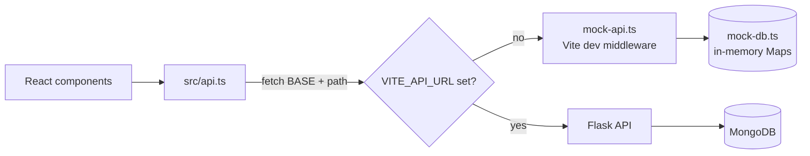
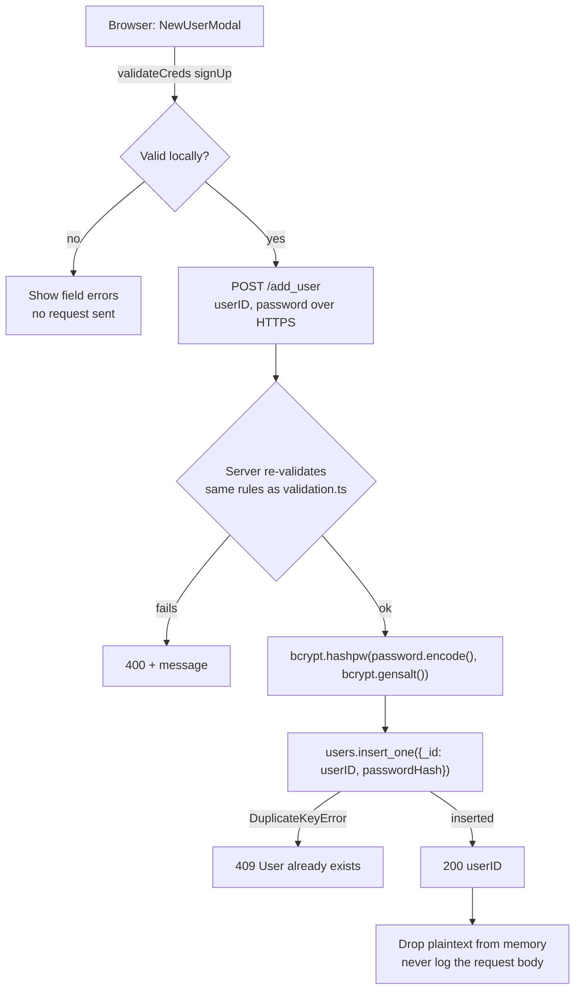
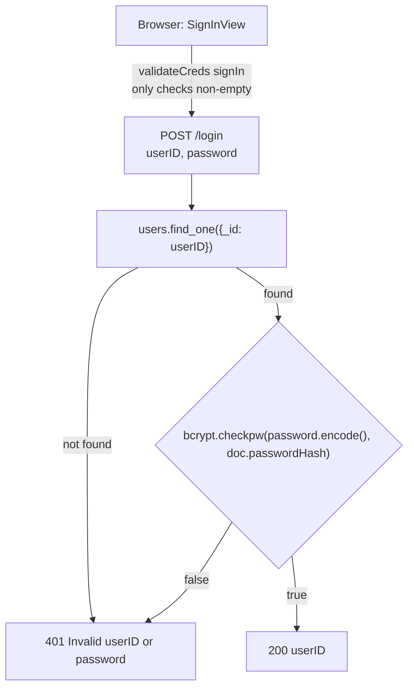
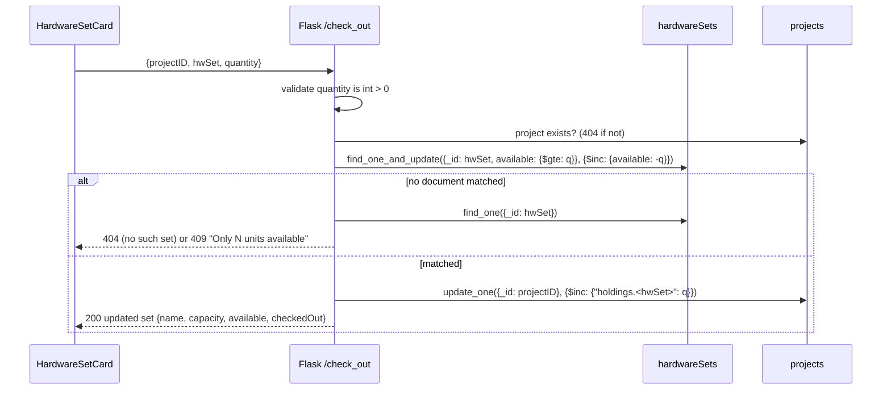

# API Roadmap: from the Mock API to Flask + MongoDB

## Our transition from the Mock API to Flask

Last updated: 10/14/26

Right now the frontend runs against a mock server (`haas-app/mock-api.ts` + `haas-app/mock-db.ts`). This doc is
our plan for switching it over to the real Flask + MongoDB backend: what has to change in
`haas-app/src/api.ts`, what the backend needs to build, and how the database should be laid out. Sections:

1. [How the frontend connects today](#1-how-the-frontend-connects-today)
2. [Existing routes the backend must match](#2-existing-routes-the-backend-must-match)
3. [Read vs. write calls, schemas, and a route template](#3-read-vs-write-calls-schemas-and-a-route-template)
4. [MongoDB collections](#4-mongodb-collections)
5. [Password hashing flow](#5-password-hashing-flow)
6. [Critical sections and race conditions](#6-critical-sections-and-race-conditions)
7. [New routes](#7-new-routes)
8. [Frontend changes (`api.ts` and friends)](#8-frontend-changes-apits-and-friends)
9. [Backend files to create](#9-backend-files-to-create)
10. [Future work and deferred items](#10-future-work-and-deferred-items)
11. [Open questions](#11-open-questions)

We started from the hand-drawn route spec in `docs/api_calls.pdf`. This doc follows it except where noted
below. The biggest differences are how passwords get checked (section 5) and the shape of
`/get_user_projects_list` (section 2).

---

## 1. How the frontend connects today



All HTTP requests go through `api.ts`. Components call the `api.*` functions and never use `fetch`
themselves.

`api.ts` builds every URL from `BASE = import.meta.env.VITE_API_URL ?? ''`. If `VITE_API_URL` isn't set,
`vite.config.ts` plugs the mock in as dev middleware and requests go to the same origin.

Any non-2xx response needs a JSON body like `{ "error": "<message>" }`. `api.ts` turns that into an
`ApiError(status, message)`, and the components show the message to the user exactly as it comes back. So
backend error messages should be written for users to read, not for us.

The frontend looks for these status codes:

- `400`: bad input
- `401`: bad login
- `404`: missing project or hardware set
- `409`: conflict (ID already taken, already a member, not enough units)
- `502`/`503`/`504`: server down, which switches the status light to offline

While the app is offline, `connection.ts` calls `/get_all_hw_names` every 5 seconds to see if the server is
back. That route needs to stay cheap and shouldn't require auth.

`session.ts` queues requests for the same `projectID:hwSet` so they run one at a time. That only helps inside
a single browser tab, though. The backend still has to handle several users hitting the same set at once
(section 6).

---

## 2. Existing routes the backend must match

`api.ts` already calls all of these, and the mock implements them. If Flask accepts the same request shapes
and returns the same statuses, the frontend should work once `VITE_API_URL` is set. The one exception is
`/get_user_projects_list`, which changes from an array to a map (below).

| Route | Method | Request | 200 response | Errors |
|---|---|---|---|---|
| `/login` | POST | `{ userID, password }` | `{ userID }` | 401 `Invalid userID or password` |
| `/add_user` | POST | `{ userID, password }` | `{ userID }` | 400 invalid creds, 409 `User already exists` |
| `/get_user_projects_list` | GET | `?userID=` | `{ projects: { [projectID]: Project } }` (empty object if none) | — |
| `/get_project_info` | GET | `?projectID=` | `{ projectID, name, description, members: string[] }` | 404 |
| `/create_project` | POST | `{ userID, projectID, name, description }` | `Project` | 400 invalid ID, 409 ID taken |
| `/join_project` | POST | `{ userID, projectID }` | `Project` | 404 no such project, 409 `You are already part of this project` |
| `/get_all_hw_names` | GET | — | `{ names: string[] }` | — |
| `/get_hw_info` | GET | `?name=` | `{ name, capacity, available }` | 404 |
| `/check_out` | POST | `{ projectID, hwSet, quantity }` | updated `HardwareSet` | 400 bad quantity, 404, 409 not enough available |
| `/check_in` | POST | `{ projectID, hwSet, quantity }` | updated `HardwareSet` | 400, 404, 409 project holds fewer units |

A few things for the backend team:

- `/get_user_projects_list` returns a **map keyed by `projectID`**, not an array:

  ```json
  { "projects": { "edgeproj42": { "projectID": "edgeproj42", "name": "...", "description": "...", "members": ["alice"] } } }
  ```

  Project IDs are already unique (they're the Mongo `_id`), so a map can't hold duplicates, and the frontend
  can look a project up by ID without scanning a list. In Flask that's one dict comprehension over
  `projects.find({"members": uid})`. Return `{ "projects": {} }` when the user has no projects. That isn't an
  error, and the frontend already shows "You are not part of any project yet." for it. Nobody should rely on
  key order; sort on the frontend if order matters. The frontend and mock changes are in section 8.
- `/join_project` should still return 409 when the user is already a member. The frontend catches that 409
  and sends them to the project anyway (`join` in `ProjectsView.tsx`). There's a commented-out version right
  below it that shows the error instead.
- Creating a project should add the creator as a member in the same request.
- `quantity` comes in as a JSON integer. Return 400 for strings, decimals, anything `<= 0`, and booleans.
  Booleans are easy to miss in Python because `True` counts as an `int`, so check `type(q) is int`.
- The server needs to repeat the checks from `validation.ts`: letters and digits only, and the minimum
  lengths (which are still placeholders). Anyone can skip the browser checks by sending requests directly.

---

## 3. Read vs. write calls, schemas, and a route template

Every route is either a **read** or a **write**, and the two need very different care. Every future issue
that adds or changes a route should say which kind it is in the issue description.

| | Read | Write |
|---|---|---|
| Routes today | `/get_user_projects_list`, `/get_project_info`, `/get_all_hw_names`, `/get_hw_info` | `/login`\*, `/add_user`, `/create_project`, `/join_project`, `/check_out`, `/check_in` |
| Method and inputs | `GET`, query string | `POST`, JSON body |
| Mongo calls | `find` / `find_one` only | `insert_one` / `update_one` / `find_one_and_update` with a condition in the filter |
| Race conditions | None. The worst case is a slightly stale value. | Every write is a critical section (section 6). |
| Retrying | Safe to retry. The offline probe does this every 5 seconds. | Never retry blindly. After a failure, refetch the state and let the user decide. |
| Response | The data asked for | The updated document, so the frontend doesn't need a second read |
| Errors | 400, 404 | 400, 404, 409 |

\* `/login` doesn't change data, but it's a `POST` so the password stays out of the URL and server logs.

Rules that follow from this:

- A read never changes the database. If a `GET` handler calls `insert`, `update`, or `delete`, it's a bug.
- A write states its critical section and the single atomic Mongo operation that protects it. If an issue
  for a new write route can't name that operation, it isn't ready to pick up.

### Schemas (Ideas)

Before writing any handlers, the backend should write the schemas down in one place, in two layers:

1. **Request/response schemas** (`backend/schemas.py`). One entry per route, matching the tables in sections
   2 and 7 and the interfaces in `api.ts`. Handlers parse the body against the schema instead of each one
   checking fields its own way. For example:

   ```python
   # Field -> exact type. `type(v) is t` rejects True for int (section 2).
   REQUESTS = {
       "/add_user":       {"userID": str, "password": str},
       "/create_project": {"userID": str, "projectID": str, "name": str, "description": str},
       "/join_project":   {"userID": str, "projectID": str},
       "/check_out":      {"projectID": str, "hwSet": str, "quantity": int},
       "/check_in":       {"projectID": str, "hwSet": str, "quantity": int},
   }
   ```

2. **Database document schemas** (`backend/db.py`). The document shapes in section 4, enforced by MongoDB
   itself with a `$jsonSchema` validator when each collection is created
   (`db.create_collection("projects", validator={"$jsonSchema": {...}})`). Then a bad write is rejected by
   the database no matter which route sent it.

If a field changes, it changes in the schema first, then in `api.ts` and the mock. That keeps the frontend,
the API, and the database agreeing on one shape.

### Route template

Every route should follow the same three steps: parse, act, respond. Handlers stay thin, and the Mongo
calls live in one function per operation where they're easy to find and test:

```python
# project_routes.py
from flask import Blueprint, request, jsonify
from errors import ApiError
from schemas import parse
import project_service

bp = Blueprint("projects", __name__)

@bp.post("/join_project")
def join_project():
    # 1. Parse: validate against the schema; parse() raises ApiError(400, ...) on bad input.
    body = parse("/join_project", request.get_json(silent=True))
    # 2. Act: one service call. Reads and writes to Mongo happen in there, never in the handler.
    project = project_service.join(body["userID"], body["projectID"])
    # 3. Respond: exactly the response schema.
    return jsonify(project), 200
```

```python
# app.py: one handler turns every ApiError into the {"error": msg} body api.ts expects.
@app.errorhandler(ApiError)
def handle_api_error(e):
    return jsonify({"error": e.message}), e.status
```

A read route uses `request.args` in step 1 instead of the JSON body, and its service function only calls
`find`/`find_one`. A write route's service function holds the critical section from section 6.

---

## 4. MongoDB collections

The mock uses five in-memory Maps. In Mongo those become three collections. Membership and holdings are
stored inside each project document, so there's only one place to update and nothing to keep in sync.

| Mock table (`mock-db.ts`) | Mongo collection | Document shape |
|---|---|---|
| `users` (userID → **plaintext** password) | `users` | `{ _id: userID, passwordHash: <bcrypt bytes> }` |
| `projects` | `projects` | `{ _id: projectID, name, description, createdBy, members: [userID], holdings: { HWSet1: 20, HWSet2: 0 } }` |
| `memberships` (userID → projectIDs) | *(folded into `projects.members`)* | — |
| `holdings` (projectID → hwSet → units) | *(folded into `projects.holdings`)* | — |
| `hardware` | `hardwareSets` | `{ _id: "HWSet1", capacity: 100, available: 70 }` |

Why we set it up this way:

- Using the ID as `_id` means we get duplicate checks for free. Inserting an ID that already exists raises
  `pymongo.errors.DuplicateKeyError`, and we return that as a 409. We never have to read first to see if the
  ID is taken, so there's no race between the read and the write. (This is what the "unique indexing" note in
  the PDF is about.)
- With `members` stored as an array, `/join_project` is one atomic update (section 6). We should also index
  `members`, since `/get_user_projects_list` runs `find({members: uid})`.
- Keeping `holdings` on the project means we can get everything a project has checked out in one read.
  Section 7.1 depends on that.

One rule always has to hold: for each set, `capacity == available + sum of every project's holdings for that
set`. The mock's seed data already follows it (there's a comment about it in `mock-db.ts`). We should write a
pytest that checks it after a mix of check-outs and check-ins.

---

## 5. Password hashing flow (Double check with DB - Due to MongoDB Encryption Demands)

Only the server hashes passwords, using bcrypt. The browser sends the plaintext password over HTTPS, and the
server never stores or logs it.

> Correction to `api_calls.pdf`: the PDF says to "hash the input password and compare it to the database
> hash". That won't work with bcrypt. Every hash gets its own random salt, so hashing the same password twice
> gives two different results. Use `bcrypt.checkpw(input, stored_hash)` instead. It pulls the salt out of the
> stored hash and does the comparison for you.

### `/add_user` (sign up)



### `/login` (sign in)



A few rules for both routes:

- An unknown user and a wrong password get the same 401 message. Otherwise someone could use the login form
  to find out which userIDs exist.
- Store `passwordHash` as the exact bytes bcrypt returns. Don't decode it, re-encode it, or trim it.
- Don't trim passwords either. The frontend doesn't, and if we started doing it later, existing users
  wouldn't be able to log in.
- The mock stores plaintext passwords on purpose (it's dev-only, and `mock-db.ts` says so). Don't carry that
  over to Flask.

---

## 6. Critical sections and race conditions

**Any route that changes the database can race with another request doing the same thing.** In the mock
nothing races, because it's single-threaded. In Flask, several workers handle requests at the same time, so
"read the value, check it in Python, write it back" can interleave with another request between the read and
the write. Every write route has a critical section, and each one needs a remedy that holds across every
worker and server.

| Route | Shared data | What goes wrong if done naively | Remedy |
|---|---|---|---|
| `/add_user` | `users._id` | Two sign-ups for the same userID both see "not taken" and both insert. | Insert with `_id: userID` and no read first. Catch `DuplicateKeyError` → 409. |
| `/create_project` | `projects._id` | Same as above for project IDs. The creator could also end up not being a member if that's a second write. | One `insert_one` of the whole document, `members: [creator]` and `holdings: {}` included. Catch `DuplicateKeyError` → 409. |
| `/join_project` | `projects.members` | Two users join at once. Each reads the array, appends in Python, and writes it back, so one join is lost. A double click could also add the same user twice. | `update_one({_id: pid, members: {$ne: uid}}, {$push: {members: uid}})`. If `matched_count == 0`, read the project to pick 404 (no project) or 409 (already a member). Never `$set` the whole array. |
| `/check_out` | `hardwareSets.available` and `projects.holdings` | Two users both see 10 available and both take 10, so `available` goes negative. | Conditional `find_one_and_update` with `available: {$gte: q}`, and both writes in one transaction (below). |
| `/check_in` | `projects.holdings` and `hardwareSets.available` | A double-clicked return gives back units the project no longer holds, so `available` goes over capacity. | Conditional update with `"holdings.<hwSet>": {$gte: q}`, and both writes in one transaction (below). |
| `/create_hardware_set` (future, section 10) | `hardwareSets._id` | Two sets created with the same name. | Insert with `_id: name`. Catch `DuplicateKeyError` → 409. |

Rules for every write, now and in future issues:

1. **Never read, check in Python, then write.** Put the check in the update's filter, so checking and
   writing happen as one step inside MongoDB.
2. **Change values relative to what's stored** (`$inc`, `$push`, `$addToSet`). Don't `$set` a value you
   computed from an earlier read.
3. **Let unique `_id`s catch duplicates** instead of checking whether something exists first.
4. **If one request changes two documents, use a transaction** (or ordered writes with an undo, below).
5. **Use the result of the write to decide the outcome** (`matched_count`, or `None` from
   `find_one_and_update`). Only read again afterwards to pick the right error message.
6. **Test it under concurrency.** A pytest that fires several check-outs at the same set from threads, then
   checks the section 4 rule, will catch a broken critical section that single-request tests miss.

### Check-out



### Check-in

Check-in is the same flow in reverse, except the condition goes on the project instead of the set:

- Update: `update_one({_id: pid, "holdings.<hwSet>": {$gte: q}}, {$inc: {"holdings.<hwSet>": -q}})`
- If nothing matches, return 409 `Project <pid> only holds N units of <hwSet>`.
- Then `$inc: {available: q}` on the set. Because of the rule from section 4, this can't go over capacity.

### Keeping the two writes consistent

Every check-out or check-in changes two documents (the set and the project), so we need some way to keep
them in sync. There are two options:

1. Mongo transactions. This is the one to use if we deploy on Atlas. Wrap both updates in
   `with client.start_session() as s: s.with_transaction(fn)`. Atlas clusters are replica sets, even on the
   free tier, so transactions work there. A plain local `mongod` doesn't support them, so for dev we'd have
   to run it with `--replSet` or use a Docker replica-set image.
2. Ordered writes with an undo, if transactions aren't available. Do the conditional update first, since
   that's the one that can fail. If the second write fails, undo the first one with the opposite `$inc` and
   return 500. This is simpler, but if the server crashes between the two writes, the counts won't add up
   anymore. That makes the section 4 test even more important.

Either way, nothing changes on the frontend. `HardwareSetCard.tsx` already refetches `/get_hw_info` after any
409 or network failure.

### A concurrent hash map is a backend tool, not a frontend one

We considered queuing requests in a concurrent hash map (like Java's `ConcurrentHashMap`; in Python, a dict
of per-key `threading.Lock`s) to stop races. This is a **backend** question. It doesn't belong in the
frontend at all:

- **In the browser it isn't needed.** JavaScript runs one thing at a time, so the plain `Map` in
  `session.ts` is already safe. That queue only puts one tab's clicks in order, and it does that correctly. A
  concurrent map there would add nothing.
- **The frontend app is single threaded.** Currently each instance of the frontend display and UI
  runs on a single thread and as a result can't be multithreaded to handle concurrent inputs and update
  accordingly as wanted.
- **On the server it can help, but only within one process.** Locking on `projectID:hwSet` inside a Flask
  worker does serialize the requests that worker handles, which takes care of races between its own threads.
  But Flask in production usually runs several worker processes, and maybe more than one instance, each with
  its own copy of the map. Two users on different workers could still both take the last 10 units. A
  single-worker dev server would hide this, so it would look like it works until deploy.
- **It lives in memory.** A server restart, or a free-tier server going to sleep, wipes it. Anything that has
  to last belongs in MongoDB.

| Goal | Where it belongs | How |
|---|---|---|
| Ordering one user's clicks | Browser (`session.ts`) | Keep the `Map` queue as is |
| Correct writes with many users | MongoDB | Conditional atomic updates and transactions (table and rules above) |
| Fewer conflicting requests inside one worker | Flask (optional) | Concurrent map / per-key locks, **on top of** the MongoDB remedies, never instead of them |

---

## 7. New routes

### 7.1 Units checked out per project

The Hardware page can't show a "Checked Out" number yet, and right now only the server enforces the check-in
limit (see the comments in `HardwareSetCard.tsx`). Instead of adding a new route for this, we can extend the
existing ones:

| Route | Change |
|---|---|
| `GET /get_hw_info?name=&projectID=` | `projectID` is optional. When given, also return `checkedOut: projects[pid].holdings[name] ?? 0` |
| `POST /check_out`, `POST /check_in` | Response also includes `checkedOut` for the request's project |

If we want a summary on the Projects page later, we could also add
`GET /get_project_hardware?projectID=` → `{ holdings: { HWSet1: 20, HWSet2: 0 } }`. That one's optional.

### 7.2 Project members (frontend done, backend needed)

`/get_project_info` already returns `members`, and the Hardware page (`ResourcesView.tsx`) already shows
them. The backend only has to return `projects[pid].members`, so no new route is needed.

### 7.3 Summary of new and changed routes

| Route | Read or write | New or changed | Needed for |
|---|---|---|---|
| `/get_user_projects_list` returns a map | read | changed | keyed lookup, no duplicates (section 2) |
| `/get_hw_info` + `projectID` param, `checkedOut` field | read | changed | Checked Out stat, client-side check-in limit |
| `/check_out`, `/check_in` + `checkedOut` in response | write | changed | Checked Out stat |
| `/get_project_hardware` | read | new, optional | per-project summary on the Projects page |
| `/create_hardware_set` | write | future (section 10) | users creating their own sets |

---

## 8. Frontend changes (`api.ts` and friends)

### `src/api.ts`

```ts
export interface HardwareSet {
  name: string
  capacity: number
  available: number
  checkedOut?: number // present when the request named a project
}

// in `api`:
getUserProjects: (userID: string) =>
  request<{ projects: Record<string, Project> }>('/get_user_projects_list' + q({ userID })),
getHardwareInfo: (name: string, projectID?: string) =>
  request<HardwareSet>('/get_hw_info' + q(projectID ? { name, projectID } : { name })),
```

### Other files that change with it

- `ProjectsView.tsx`: `refresh` reads the map, e.g. `setProjects(Object.values(res.projects ?? {}))`, or keep
  the map in state if lookups by ID are needed.
- `HardwareSetCard.tsx`:
  - Use `hwSet.checkedOut` as the check-in `max` in `validateQuantity` instead of `Number.MAX_SAFE_INTEGER`.
  - Uncomment the Checked Out stat and switch to `hw-stats-3`.
  - **Future feature (after the checkpoint): units this project holds, from a backend endpoint that does not exist yet
- `ResourcesView.tsx`: call `getHardwareInfo(n, projectID)` so `checkedOut` comes back.
- The mock (`mock-api.ts`, `mock-db.ts`):
  - `/get_user_projects_list` returns `Object.fromEntries` of the user's projects instead of an array.
  - Add `checkedOut` to the hardware responses, so `npm run dev` and the tests keep working without a backend.
  - Update `mock-api.test.ts` and `src/api.test.ts` for the new shapes.

### Config files to add

We need a `haas-app/.env.example` (checked in) with `VITE_API_URL=http://localhost:5000`. The real `.env`
stays gitignored.

In dev, Vite runs on port 5173 and Flask runs on 5000. Those count as different origins, so the browser will
block the API calls unless we do one of these:

1. Use Vite's `server.proxy` to forward the API routes to Flask. This is the better option since it doesn't
   add a dependency. Set it up in `vite.config.ts` and leave `VITE_API_URL` unset. The catch is that the mock
   currently turns on whenever `VITE_API_URL` is unset, so it would need its own switch (something like
   `VITE_USE_MOCK=1`).
2. Add CORS headers in Flask. Set `Access-Control-Allow-Origin` to the frontend's origin in an
   `@app.after_request` hook, and handle `OPTIONS` preflight requests.

In production, if we can serve the built frontend and the API from the same origin, we won't need either one.

---

## 9. Backend files to create (Suggested based on roadmap - Can change based on DB and Backend Decisions)

This is only a suggested layout. The backend team gets the final say on structure.

```
backend/
  app.py              Flask app factory, registers blueprints, ApiError handler → {"error": msg}
  errors.py           ApiError(status, message)
  schemas.py          request/response schema per route + parse() (section 3)
  db.py               one MongoClient from MONGO_URI env var; collection handles; $jsonSchema validators; indexes
  auth_routes.py      /login, /add_user (bcrypt)
  project_routes.py   /create_project, /join_project, /get_user_projects_list, /get_project_info
  project_service.py  Mongo reads/writes for projects (critical sections live here)
  hw_routes.py        /get_all_hw_names, /get_hw_info, /check_out, /check_in
  hw_service.py       Mongo reads/writes for hardware sets (critical sections live here)
  validation.py       same rules as haas-app/src/validation.ts
  seed.py             creates HWSet1/HWSet2 (capacity 100) if missing
  tests/              pytest: one file per routes module + invariant test + concurrency test (section 6)
  requirements.txt    flask, pymongo, bcrypt, pytest
  .env.example        MONGO_URI=..., FLASK_ENV=development
```

A few things to get right:

- Create one `MongoClient` per process, in `db.py`, instead of a new one for every request.
- `MONGO_URI` and any other secrets come from environment variables, and `.env` stays out of git (see
  CLAUDE.md).
- Map Mongo errors to status codes: `DuplicateKeyError` → 409, a missing document → 404, and anything else →
  500 with a generic message. Log the details on the server, but never log the request body on the auth
  routes.

---

## 10. Future work and deferred items

- **Users creating their own hardware sets.** Add a write route:

  | Route | Method | Request | 200 response | Errors |
  |---|---|---|---|---|
  | `/create_hardware_set` | POST | `{ userID, name, capacity }` | `HardwareSet` | 400 bad name or capacity, 409 name taken |

  - `capacity` follows the same rule as `quantity`: a real integer `> 0`, no booleans.
  - A new set starts with `available == capacity`, so the section 4 rule holds from the start.
  - The insert uses `_id: name`, so duplicates are caught by `DuplicateKeyError` (section 6).
  - The Hardware page already gets set names from `/get_all_hw_names`, so new sets show up without any
    hard-coding (R2-2). The frontend only needs a create form.
  - Still to decide: can any user create a set, or only project members/admins? Are sets global or tied to a
    project? Can capacity change later? (Changing capacity while units are checked out is its own critical
    section.)
- **Authorization.** Right now any signed-in user can call `/check_out` for any project ID. Eventually the
  backend should check that `userID ∈ projects[pid].members` before changing holdings, and return 403 if it
  isn't. Put the membership check in the update filter, so it's part of the same atomic step. This has to
  happen on the server, because anyone can send the request without going through the UI.
- **Sessions and tokens.** `userID` is kept in React state and sent with each request. With a real session (a
  signed cookie or a token), the server could work out the `userID` on its own instead of trusting the request
  body. Until then, nothing proves that the `userID` in a request actually belongs to whoever is signed in.
- **Removed: user and project history (POSSIBLE 50-50 Comeback).** An earlier draft planned a `transactions` 
  collection and `/get_user_history` / `/get_project_history` routes. A history that's actually useful (browsing past
  states, undoing, seeing who changed what) means storing every change as a chain of versions. That's
  essentially building our own version control (a tree of states, like git), which is far bigger than this
  project. We dropped it, along with the `userID` field it would have added to `/check_out` and `/check_in`.

---

## 11. Open questions

- Backend stack: the README's "Toolchain and Approach" table still says Node.js + Java, but CLAUDE.md and the
  team table say Python Flask. This doc assumes Flask. We should update the README once the team confirms.
- Validation lengths: `MIN_USERID_LENGTH`, `MIN_PASSWORD_LENGTH`, and `MIN_PROJECT_ID_LENGTH` in
  `validation.ts` are still 0. The frontend and backend need to agree on the real values.
- Dev database: will dev run against Atlas (which has transactions) or a local `mongod` (which would need
  replica-set mode for option 1 in section 6)?
